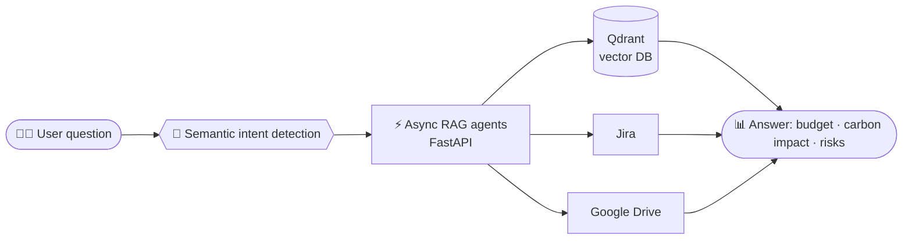

 

---

## 👩‍💻 About me

I'm a **computer science & AI engineer** (ENSA Safi, *Mention Bien*) who bridges **enterprise Java** and **modern AI**.
I build secure, scalable backends with **Spring Boot**, reactive frontends with **React**, and **RAG-based AI assistants** that turn real project data into answers.

- 🤖 Built the **AI assistant** of a project-steering SaaS: it analyses real data from **Jira** and **Google Drive** to track budget, carbon impact and risks
- 🔐 Secured **microservices** with a stateless **JWT forwarding** model that removes authentication bottlenecks
- 📴 Designed **levelUp**, an offline classroom quiz platform with QR code result transfer
- 🧩 Passionate about **system design**, microservices and clean architecture

---

## 🧠 How my AI assistant works (simplified)

---

## 🛠️ Tech stack

  

  
  
  
  
  
  
  
  
  

---

## 🚀 Featured projects

| Project | What it does | Stack |
|---|---|---|
| **[MintTrack](LINK)** | Centralised CMMS platform for industrial maintenance: breakdown tracking, real-time asset health, role-based access (Admin / Operator), KPI dashboards and PDF export | Spring Boot · Spring Security (JWT) · React · PostgreSQL · FastAPI |
| **[levelUp](LINK)** | Offline classroom evaluation: preloaded questions, answers stored offline then sent to the teacher by QR code, with near real-time follow-up | Spring Boot · Spring Security (JWT) · React |
| **[TalentMatch](LINK)** | LinkedIn-inspired platform connecting companies with qualified candidates | Spring Boot · Spring Security (JWT) · React |

---

## 💼 Experience

- **Junior Full-Stack Developer (final-year project)**, IZEMX — *2026*
  AI assistant (RAG) for a project-steering SaaS, microservices security, Budget/Assistant module.
- **Web Developer (end-of-year project)**, Yane Code Digitale — *July 2025*
  Tech-news and opportunities magazine, with an admin space to publish content.

## 🎓 Education & certification

- 🎓 Engineering degree in Computer Science & AI, **ENSA Safi** — 2021–2026 (*Mention Bien*)
- 📜 **Oracle Java Foundations** — 2024

---

## 📊 GitHub stats

  
  

---

## 📫 Let's connect

Open to opportunities and collaborations. The best way to reach me: **ayachkiro@gmail.com**

